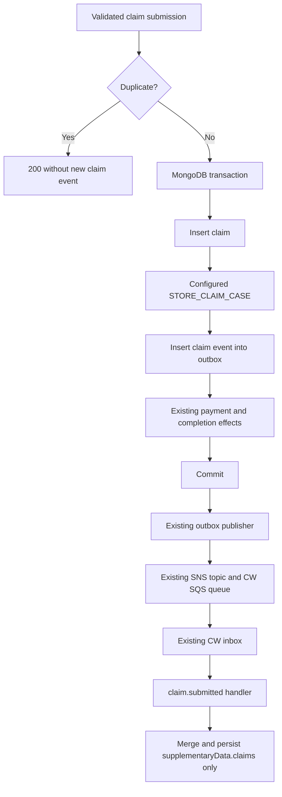

# Deliver submitted claims to Caseworking

## Intent and scope

[FGP-1382](https://eaflood.atlassian.net/browse/FGP-1382) requires a successfully created claim and its Caseworking event to commit in the same MongoDB transaction. A duplicate submission must produce no additional event. Caseworking must store the received claim as supplementary data.

The user approved reusing the existing outbox and supplementary-data machinery, with a claim-specific handler in each backend. **Receiving claim data must not change the case status.** Woodland's existing automatic completion and payment paths remain responsible for their respective effects. This design covers the GAS producer, CW consumer, and activation in Woodland's `next` GAS definition as one delivery feature.

> [!IMPORTANT]
> Woodland `gas.next.json` sets `requiresApproval: false` and configures `claims.onClaimApproval` to move from Awaiting Claim to Claim Complete. Existing GAS submission logic already emits the separate Caseworking status command. This feature must neither duplicate nor suppress that command.

## Existing behaviour

- GAS `submitClaim` validates identity and capacity, inserts an immutable Claim, and applies applicable payment and application-transition effects inside `withTransaction`.
- Duplicate checks return `{ created: false }` before insertion, including after concurrent duplicate-key failures.
- `STORE_AGREEMENT_CASE` builds supplementary data and enqueues an `UpdateCaseStatusCommand` with the caller's session. It is a useful pattern, but it also stores an agreement and couples data attachment to case progression.
- `saveEvents`, `CloudEvent`, the outbox publisher, and the current FIFO topic/queue already supply durable delivery, tracing, grouping, and retries.
- CW ingests the GAS update queue into its inbox and dispatches by CloudEvent type. Its Case model already merges supplementary-data array entries by a nominated key.
- CW's general case repository `update` replaces the entire case document. A data-only consumer must use a narrower write to avoid overwriting concurrent status or task changes.

## Alternatives and decision

| Approach                                                               | Consequence                                                                                                                         |
| ---------------------------------------------------------------------- | ----------------------------------------------------------------------------------------------------------------------------------- |
| **New `claim.submitted` event over the existing transport — selected** | Matches the ticket's event example and reuses delivery and storage, with a small consumer handler that has no status effects.       |
| Reuse `case.update.status` with a claims node                          | Reuses the existing consumer directly, but invokes case progression and requires a status in an event intended only to attach data. |
| New generic supplementary-data event or new transport                  | Adds a broader interface or infrastructure that this claim feature does not require.                                                |

## Submission configuration and execution

Add an optional block to the GAS grant definition:

```json
{
  "claims": {
    "onSubmission": {
      "processes": ["STORE_CLAIM_CASE"]
    }
  }
}
```

`onSubmission` is an object with a required `processes` array. The array accepts the known process name `STORE_CLAIM_CASE`, rejects duplicate entries and unknown process names, and may be empty to disable the effect. Absence of the entire block also disables it, preserving existing grants. Validate the hook on both the grant API and published-definition loading path; the existing Grant object retains the claims configuration. Do not change the existing status-transition process dispatcher.

The submission path uses the application's already resolved, pinned grant definition. After the claim insertion succeeds, run the configured submission process with the saved Claim, its Mongo ID, and the same MongoDB session. Queue the claim event before the existing final-claim transition. The hook runs for every newly inserted claim, including partial claims, claims with further capacity remaining, and claims requiring approval. It never runs for a duplicate request.

The handler does not reread the claim, application, or configuration. Keep access to the saved Claim internal to the submission path; preserve the current public response shape and audit behaviour.

Enable this hook in `grants-config-woodland/configurations/woodland/gas/gas.next.json`. Leave the default Woodland definition and both CW definitions unchanged. No manual approval flow, historical backfill, new UI, or generic process framework is included.

## Event contract

Use the existing `CloudEvent` base with the suffix `claim.submitted`, producing `cloud.defra.<environment>.fg-gas-backend.claim.submitted`. Reuse its identity, timestamp, source, trace context, and content metadata. Use `${caseRef}-${workflowCode}` for message grouping, consistent with case status commands.

Publish to `config.sns.updateCaseStatusTopicArn`. The existing CW update queue accepts and stores CloudEvents without interpreting the payload; add the new type to CW's inbox dispatch map. No additional topic, queue, environment variable, or publisher implementation is needed.

Each newly created claim produces one event with one entry in `data.claims`:

```json
{
  "caseRef": "wmp-6hb-j8e",
  "workflowCode": "woodland",
  "claims": [
    {
      "gasClaimId": "507f1f77bcf86cd799439011",
      "clientClaimRef": "WMP-6HB-J8E-C0001",
      "claimCode": "ENT_CS_CAPITAL_PA3",
      "claimAmountPence": 150000,
      "sbi": "113593357",
      "status": "SUBMITTED",
      "submittedAt": "2026-08-07T11:16:05.745Z"
    }
  ]
}
```

| Event field        | Source                                                                            |
| ------------------ | --------------------------------------------------------------------------------- |
| `caseRef`          | Saved Claim `metadata.clientRef`, validated against the URL                       |
| `workflowCode`     | Saved Claim `metadata.grantCode`, validated against the URL                       |
| `gasClaimId`       | Actual inserted Mongo `_id`, converted to a string                                |
| `clientClaimRef`   | Saved Claim `clientClaimRef`                                                      |
| `claimCode`        | Saved Claim `claimCode`, derived from the entitlement                             |
| `claimAmountPence` | Saved Claim `claim.totalClaimAmountPence`                                         |
| `sbi`              | Saved Claim `metadata.sbi`                                                        |
| `status`           | Literal `SUBMITTED`, describing this event rather than adding mutable Claim state |
| `submittedAt`      | Saved Claim `createdAt`, consistent with the current submitted-claim view         |

The current API forbids caller-supplied `metadata.claimCode`; the entitlement-derived saved value is authoritative. The event deliberately maps the current API's `totalClaimAmountPence` to the ticket's `claimAmountPence`. Do not copy arbitrary request fields into the event or log claim payloads.

## Caseworking ingestion

The new inbox handler validates the complete event data before writing: nonempty case and workflow references, a nonempty claims array, required nonempty identifiers, a nonnegative integer amount, string SBI, literal `SUBMITTED`, and an ISO submission timestamp. Reject duplicate `gasClaimId` entries within one payload. The producer sends one claim, but the consumer accepts multiple entries to match the array contract.

Find the existing case by `caseRef` and `workflowCode`. Merge each entry using `Case.updateSupplementaryData` with `targetNode: "claims"`, `dataType: "ARRAY"`, and `key: "gasClaimId"`. A repeated delivery replaces the existing claim entry rather than appending a duplicate. Different claims remain present.

Persist only `supplementaryData.claims` using a targeted repository update. Do not call the general whole-document replacement, `progressTo`, position validation, workflow resolution, or status publication. Position, phase/stage tasks, timeline, assignment, and other supplementary-data nodes remain untouched. Existing inbox grouping serializes claim deliveries for a case; the targeted write also protects concurrent updates to unrelated case fields.

If the case is missing or the payload is invalid, let the existing inbox failure/retry/dead-letter machinery record the failure. Do not report successful processing or create a new case. A failed write must also propagate for retry. Redelivery after a successful write but before inbox completion is safe because the claim merge is keyed by GAS ID.

## Data flow



If any transactional step fails, the claim and its event roll back together and the existing API error handling applies. SNS delivery happens after commit, through the outbox. Neither asynchronous publication nor a CW failure changes the successful API response once the transaction has committed.

## Verification requirements

- Producer mapping test uses the real Mongo ID, saved amount/code/timestamp, zero amount, and representative metadata; event contains no case status command fields.
- Grant configuration tests cover absence, an empty process list, valid activation, unknown process names, duplicate names, API persistence, and published-definition validation.
- Mongo replica-set integration tests prove exactly one claim event for a new claim; no extra event for sequential or concurrent replays; and rollback of both claim and event when either insertion fails.
- Submission tests cover requires-approval claims, partial/multiple claims, absent completion configuration, disabled hook, and a final Woodland-style claim. Existing payment and status effects retain their prior behaviour.
- CW tests cover append, keyed redelivery, multiple claims, malformed payloads, missing cases, failed writes, dispatch through the inbox, and preservation of status, tasks, timeline, unrelated supplementary data, and concurrent unrelated document updates.
- Add a producer/consumer contract case using the real GAS event builder and CW's consumer expectations, following the existing Pact setup.
- Run the relevant unit and database integration suites, existing claim completion/payment regressions, contract verification where the local Pact setup permits it, and lint/format checks in each changed repository. Record unavailable external checks explicitly.

## Rollout and review status

Deploy the CW handler before enabling the producer hook in a published grant definition. GAS may be deployed with the hook absent without sending the new event. The existing local transport has no event-type filter; deployment must also confirm that deployed subscriptions permit `claim.submitted` before activation. No deployment or publishing is authorised by this implementation request.

- [x] Existing GAS, CW, and Woodland next paths inspected.
- [x] Design self-reviewed against FGP-1382 and the user's status constraint.
- [ ] User review of this written design.
- [ ] Detailed implementation plan and execution-method selection.
- [ ] Implementation, automated verification, and independent review.
